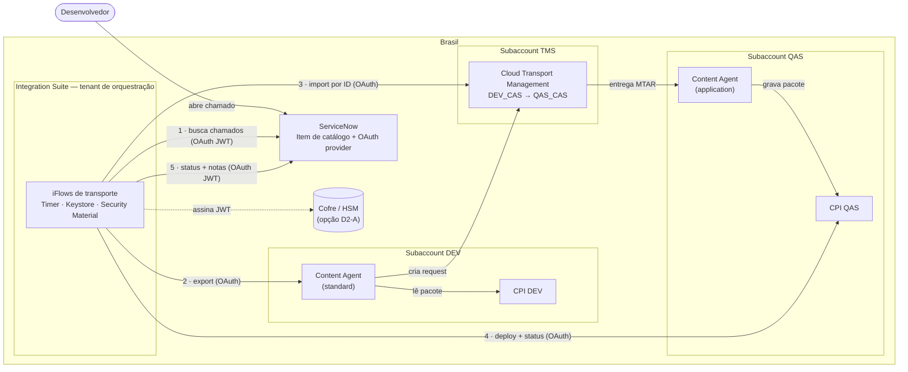
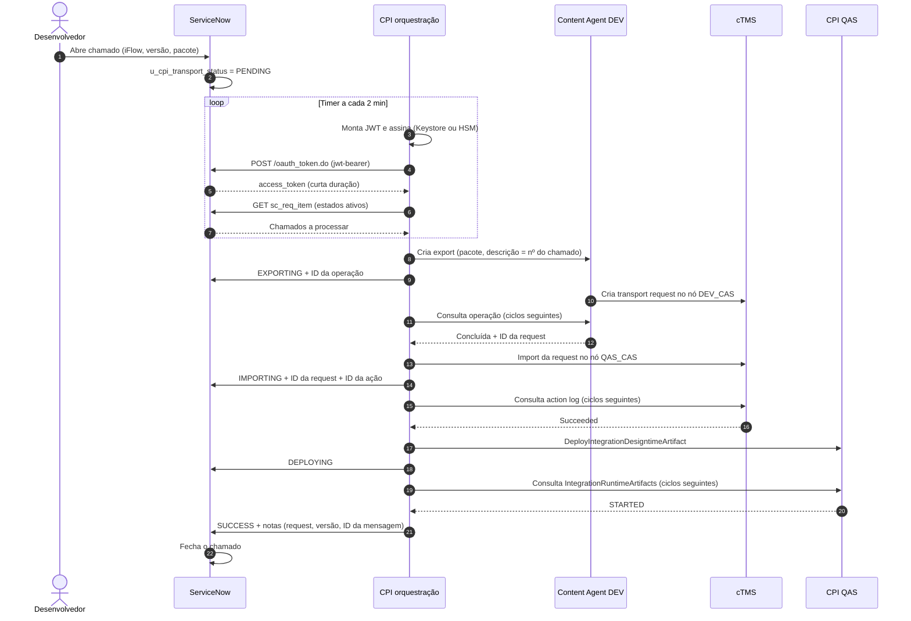
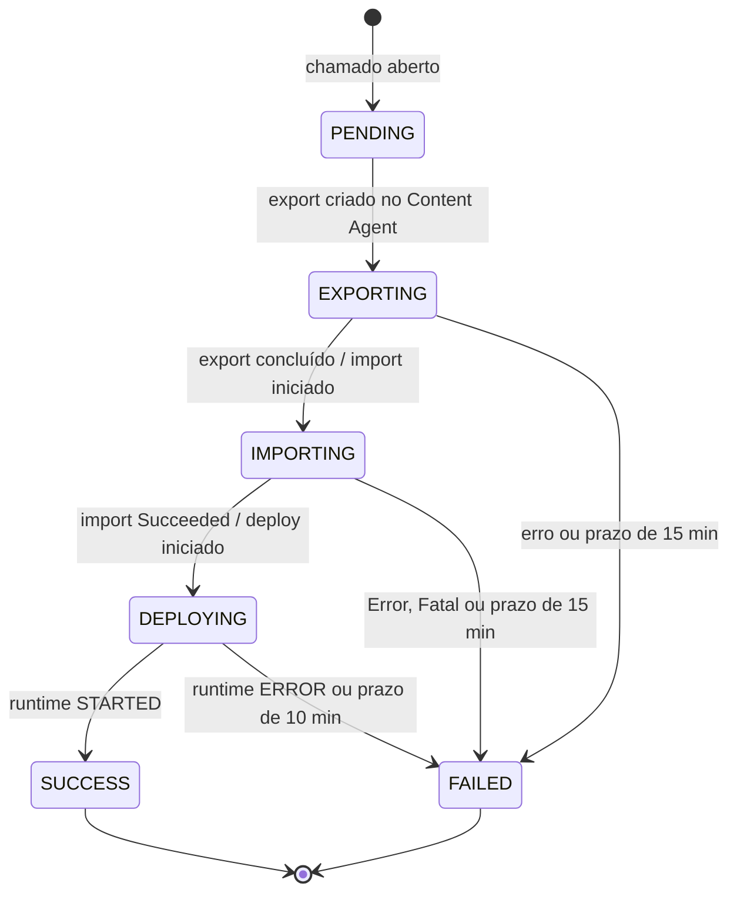

# Arquitetura — Transporte automatizado de iFlows do SAP Integration Suite

**Documento de arquitetura · versão 1.0 · 29 de outubro de 2026 · Autor: João Pedro (SAP Basis / BTP)**

Status: **proposta para revisão** com Arquitetura e Segurança da Informação.

---

## Sumário

1. [Resumo executivo](#1-resumo-executivo)
2. [Contexto e problema](#2-contexto-e-problema)
3. [Requisitos](#3-requisitos)
4. [Decisões de arquitetura](#4-decisões-de-arquitetura)
5. [Visão da solução](#5-visão-da-solução)
6. [Componentes](#6-componentes)
7. [Fluxo ponta a ponta](#7-fluxo-ponta-a-ponta)
8. [Máquina de estados do chamado](#8-máquina-de-estados-do-chamado)
9. [Autenticação e gestão de segredos](#9-autenticação-e-gestão-de-segredos)
10. [Especificação das iFlows de orquestração](#10-especificação-das-iflows-de-orquestração)
11. [Especificação do lado ServiceNow](#11-especificação-do-lado-servicenow)
12. [Requisitos não funcionais](#12-requisitos-não-funcionais)
13. [Operação e monitoramento](#13-operação-e-monitoramento)
14. [Produção (fase 2)](#14-produção-fase-2)
15. [Alternativas avaliadas](#15-alternativas-avaliadas)
16. [Riscos](#16-riscos)
17. [Decisões pendentes e perguntas abertas](#17-decisões-pendentes-e-perguntas-abertas)
18. [Roadmap](#18-roadmap)
19. [Documentos relacionados e fontes](#19-documentos-relacionados-e-fontes)

---

## 1. Resumo executivo

Hoje o transporte de iFlows entre ambientes do SAP Integration Suite (CPI) é manual: o desenvolvedor clica em **Transport** no CPI DEV e alguém importa a request no Cloud Transport Management (cTMS) e faz o deploy em QAS.

Esta arquitetura propõe que **o desenvolvedor só abra um chamado no ServiceNow** e que todo o resto aconteça sozinho, com rastreabilidade completa:

- **Transporte** no desenho de referência da SAP: **Content Agent + Cloud Transport Management**.
- **Orquestração** por iFlows no próprio **SAP Integration Suite, no Brasil**.
- **ServiceNow** como porta de entrada, servidor de autorização (OAuth 2.0 com JWT assinado por certificado, conforme o padrão do Hub de Arquitetura) e registro de auditoria.

Toda a cadeia (dados, credenciais e metadados) fica **no Brasil**, e a chave privada fica em cofre, como exige o padrão de segurança do banco.

Escopo desta versão: **DEV → QAS**. Produção está desenhada na seção 14 como fase 2.

---

## 2. Contexto e problema

### 2.1 Situação atual

| Item | Hoje |
| --- | --- |
| Modo de transporte do CPI DEV | Transport Management Service (o próprio CPI empacota e envia ao cTMS) |
| Geração da transport request | Manual, pelo botão **Transport** |
| Import em QAS | Manual no cTMS (parcialmente automatizado via SAP Automation Pilot, rota `CTMS_IMPORT`) |
| Deploy em QAS | Manual no CPI QAS |
| Rastreabilidade | Descrição livre na request; sem vínculo formal com chamado |
| cTMS | Subaccount central (TMS) no Brasil |

### 2.2 Problemas

1. **Esforço manual e espera** entre o fim do desenvolvimento e o iFlow rodando em QAS.
2. **Sem vínculo** entre mudança (chamado) e request de transporte, o que dificulta a auditoria.
3. **Riscos de fila:** imports manuais podem levar requests de outros desenvolvedores junto.
4. **No modo atual não existe API documentada** para gerar a request: o export depende do clique.
5. A primeira versão da automação usava o **SAP Automation Pilot, disponível só na Europa**. Isso levava credenciais e metadados para fora do Brasil e esbarrava no padrão de cofre de segredos.

---

## 3. Requisitos

### 3.1 Funcionais

| ID | Requisito |
| --- | --- |
| RF-01 | O desenvolvedor solicita o transporte de **um iFlow** (ID técnico, versão, pacote) por meio de um item de catálogo no ServiceNow |
| RF-02 | A solução gera a transport request, importa **somente essa request** em QAS e faz o deploy do iFlow |
| RF-03 | O chamado recebe o resultado: status, ID da request, versão, identificadores técnicos e motivo da falha, se houver |
| RF-04 | Falhas não podem fechar o chamado como sucesso |
| RF-05 | A solução não pode importar requests que não pertençam ao chamado |

### 3.2 Requisitos do padrão do banco (Hub de Arquitetura)

| ID | Requisito | Origem |
| --- | --- | --- |
| RS-01 | Integração com o ServiceNow via **OAuth 2.0, grant `urn:ietf:params:oauth:grant-type:jwt-bearer`**, com JWT assinado por certificado X.509 (RSA/ECDSA) | Hub de Arquitetura |
| RS-02 | Cliente OAuth identificado por **client_id e certificado**; chave pública registrada no servidor de autorização | Hub de Arquitetura |
| RS-03 | **Access token de curta duração**, com escopos restritos | Hub de Arquitetura |
| RS-04 | **Chaves privadas e certificados em cofre de segredos / HSM**, com controle de acesso e auditoria | Hub de Arquitetura |
| RS-05 | Dados, credenciais e metadados no Brasil (residência) | Compliance (a validar) |
| RS-06 | Menor privilégio em todas as credenciais | Segurança |

### 3.3 Restrições

| ID | Restrição |
| --- | --- |
| RT-01 | O SAP Automation Pilot só está disponível para a conta numa região da Europa |
| RT-02 | O cTMS e os tenants CPI estão no Brasil |
| RT-03 | A API de export do Content Agent precisa ser confirmada na documentação oficial (ver seção 17) |

---

## 4. Decisões de arquitetura

| ID | Decisão | Motivo |
| --- | --- | --- |
| **AD-01** | Migrar o transporte para **Content Agent + cTMS** | É o desenho de referência da SAP; o Content Agent oferece APIs para o export (a confirmar, RT-03), o que permite gerar a request sem clique. Ver `MIGRACAO-CPI.md` |
| **AD-02** | **Orquestrar no SAP Integration Suite (Brasil)**, não no Automation Pilot | Atende RS-04 e RS-05 sem exceção; plataforma já aprovada e operada pelo banco; assina JWT nativamente com o Keystore |
| **AD-03** | **Modelo pull:** o CPI consulta o ServiceNow periodicamente; o ServiceNow não chama o CPI | Uma única direção de integração, no padrão já aprovado do ServiceNow (RS-01); nenhum endpoint de entrada exposto |
| **AD-04** | **Máquina de estados persistida no chamado**, avançada a cada ciclo do timer, sem espera ativa dentro da iFlow | Robustez (sobrevive a reinícios), nenhuma mensagem longa no CPI, auditoria natural no próprio chamado |
| **AD-05** | **Importar por ID da request**, nunca a fila inteira | RF-05 |
| **AD-06** | **Um iFlow por chamado** | Granularidade acordada; deploy previsível |
| **AD-07** | **Uma credencial por consumidor e por ambiente** | RS-06; revogação isolada |

---

## 5. Visão da solução

### 5.1 Diagrama de contexto



### 5.2 Princípios

- **Um único sentido de chamada para o ServiceNow:** sempre do CPI para o ServiceNow.
- **Conteúdo dos iFlows nunca sai do Brasil:** DEV → cTMS → QAS.
- **Nenhum segredo fora de cofre:** chave do JWT no Keystore do CPI ou no HSM; demais credenciais no Security Material do CPI.
- **Chamado = fonte da verdade** do estado de cada transporte.

---

## 6. Componentes

| Componente | Local | Responsabilidade | Situação |
| --- | --- | --- | --- |
| ServiceNow | SaaS do banco | Item de catálogo; servidor de autorização OAuth JWT; estado e auditoria do transporte | Existente; configurar item, campos e cliente OAuth |
| **Integration Suite — orquestração** | Subaccount no Brasil (ver D1) | Executar a máquina de estados: buscar chamados, exportar, importar, fazer o deploy e responder | Novo (iFlows) |
| Content Agent (DEV) | Subaccount DEV | Montar o pacote e criar a request no cTMS | Novo (migração AD-01) |
| Cloud Transport Management | Subaccount TMS | Fila, nós `DEV_CAS` e `QAS_CAS`, rota, action log | Existente; nós e rota novos |
| Content Agent (QAS) | Subaccount QAS | Receber o MTAR e gravar no CPI QAS | Novo |
| CPI QAS | Subaccount QAS | Destino do deploy | Existente; instância `api` dedicada ao deploy |
| Cofre / HSM | Infra do banco | Guardar a chave ou assinar o JWT (D2) | Existente no banco |
| SAP Cloud Connector | Rede do banco | Acesso do CPI ao cofre on-premise (só se D2 = A) | Existente ou a instalar |
| SAP Automation Pilot | Europa | **Fora do caminho crítico.** Catálogo mantido como referência e contingência de laboratório | Existente |

---

## 7. Fluxo ponta a ponta

### 7.1 Sequência



### 7.2 Descrição dos passos

1. O desenvolvedor salva a versão do iFlow em DEV e abre o chamado.
2. O ServiceNow grava `PENDING` (sem chamada de saída).
3. A cada ciclo, a iFlow de orquestração obtém um token do ServiceNow (JWT assinado) e lista os chamados em estados ativos.
4. Para cada chamado, executa **um único passo** conforme o estado atual (seção 8) e grava o novo estado.
5. Nenhum passo espera dentro da iFlow: a consulta de status acontece no ciclo seguinte. Os prazos máximos por estado são controlados pelo campo de data/hora do estado.

---

## 8. Máquina de estados do chamado



| Estado | Ação no ciclo | Transição | Prazo |
| --- | --- | --- | --- |
| `PENDING` | Valida campos; cria o export no Content Agent DEV (descrição = nº do chamado) | `EXPORTING` | — |
| `EXPORTING` | Consulta a operação de export | Concluída → inicia o import da request em `QAS_CAS` → `IMPORTING` | 15 min |
| `IMPORTING` | Consulta o action log do cTMS | `Succeeded`/`Warning` → chama o deploy → `DEPLOYING`; `Error`/`Fatal` → `FAILED` | 15 min |
| `DEPLOYING` | Consulta `IntegrationRuntimeArtifacts` | `STARTED` → `SUCCESS`; `ERROR` → `FAILED` | 10 min |
| `SUCCESS` / `FAILED` | Nenhuma (estado final) | — | — |

**Contingência se a API de export não for confirmada:** o estado `PENDING` é substituído por `WAITING_TR`. O desenvolvedor clica em Transport e escreve o nº do chamado na descrição da request; a iFlow procura na fila de `QAS_CAS` a request cuja descrição contém o nº do chamado (prazo de 60 min) e segue para `IMPORTING`. O resto não muda.

**Erros transitórios** (429, 5xx, timeout de rede) não mudam o estado: o passo é repetido no próximo ciclo e o contador `u_cpi_retries` aumenta. Com 5 tentativas, o estado vai para `FAILED`.

---

## 9. Autenticação e gestão de segredos

### 9.1 Matriz de autenticação

| Origem → Destino | Mecanismo | Credencial | Armazenamento |
| --- | --- | --- | --- |
| CPI orquestração → ServiceNow | OAuth 2.0 JWT bearer (RS-01) | client_id + client_secret + chave privada | Chave: Keystore do CPI (D2-B) ou HSM (D2-A); client_id/secret: Security Material (User Credentials) |
| CPI orquestração → Content Agent DEV | OAuth 2.0 client credentials | Service key `standard` dedicada | Security Material (OAuth2 Client Credentials) |
| CPI orquestração → cTMS | OAuth 2.0 client credentials | Service key `standard` dedicada | Security Material |
| CPI orquestração → CPI QAS | OAuth 2.0 client credentials | Instância `api` com `WorkspaceArtifactsDeploy` + `MonitoringDataRead` | Security Material |
| Content Agent DEV → cTMS | Destination `TransportManagementService` | Key do cTMS + `sourceSystemId` | Destination BTP (DEV) |
| cTMS → Content Agent QAS | Destination `CAS_QAS` | Key `application` do QAS | Destination BTP (TMS) |
| Content Agent ↔ CPI | Destinations `CloudIntegration` | Instâncias `api` de transporte | Destinations BTP (DEV e QAS) |

Opcional: as service keys do BTP podem usar credencial **X.509** em vez de client secret, se a Segurança exigir certificado também nesses saltos.

### 9.2 JWT para o ServiceNow

| Elemento | Valor |
| --- | --- |
| Endpoint | `POST https://<instancia>.service-now.com/oauth_token.do` |
| Parâmetros | `grant_type=urn:ietf:params:oauth:grant-type:jwt-bearer`, `client_id`, `client_secret`, `assertion=<JWT>` |
| Header do JWT | `alg` = `RS256`; `typ` = `JWT`; `kid` = Key ID do JWT Verifier Map |
| Claims | `iss` = client_id; `aud` = client_id; `sub` = usuário de integração (campo definido em "User Field"); `iat`; `exp` = agora + 5 min; `jti` = UUID |
| Validade do access token | Curta (ex.: 30 min); obtido a cada ciclo, sem refresh token |

> **A confirmar com o time do ServiceNow:** se o servidor de autorização é o OAuth provider do ServiceNow ou o IdP corporativo, e se o parâmetro esperado é `assertion` (jwt-bearer do ServiceNow) ou `client_assertion`.

### 9.3 Onde fica a chave privada (decisão D2)

| Opção | Funcionamento | Aderência a RS-04 | Complexidade |
| --- | --- | --- | --- |
| **D2-A · HSM assina** | A iFlow monta header e payload e pede ao cofre/HSM só a assinatura (via Cloud Connector, se on-premise). A chave nunca sai do HSM | Total | Média |
| **D2-B · Keystore do CPI** | A chave fica no Keystore do tenant (Brasil), acessada só pela iFlow; a assinatura é feita por script Groovy | Alta, se a Segurança aceitar o Keystore do CPI como cofre | Baixa |
| D2-C · Cofre entrega a chave | A iFlow busca a chave no cofre a cada ciclo e assina | Média (a chave passa pela memória do runtime) | Média |

**Recomendação:** D2-B se a Segurança já aceita o Keystore do CPI para chaves de cliente (como em certificados de B2B); caso contrário, D2-A.

### 9.4 Ciclo de vida das chaves

- Par de chaves **exclusivo** para esta integração.
- Certificado com validade definida; rotação **antes** do vencimento, com dois JWT Verifier Maps ativos durante a troca (o ServiceNow aceita vários).
- Service keys do BTP: uma por consumidor, rotação semestral registrada.
- Revogação imediata em caso de incidente: remover o verifier map no ServiceNow e as keys no BTP.

---

## 10. Especificação das iFlows de orquestração

### 10.1 Pacote e artefatos

Pacote `Z_TRANSPORTE_CPI` no tenant de orquestração:

| iFlow | Gatilho | Função |
| --- | --- | --- |
| `IF_TRP_01_Orchestrator` | Timer, a cada 2 min, no horário de operação | Obtém o token, lista os chamados ativos, envia cada um ao `IF_TRP_02` |
| `IF_TRP_02_AdvanceTicket` | ProcessDirect `/trp/advance` | Roteia pelo estado e executa um passo da máquina de estados |
| `IF_TRP_03_SnowToken` | ProcessDirect `/trp/snow-token` | Monta e assina o JWT e troca pelo access token |
| `IF_TRP_04_SnowUpdate` | ProcessDirect `/trp/snow-update` | PATCH no chamado (estado, IDs, notas, contador de tentativas) |

### 10.2 Security Material

| Nome | Tipo | Conteúdo |
| --- | --- | --- |
| `TRP_SNOW_CLIENT` | User Credentials | client_id / client_secret do cliente OAuth no ServiceNow |
| `trp_snow_jwt` | Key pair (Keystore) | Chave privada + certificado do JWT (D2-B) |
| `TRP_CAS_DEV` | OAuth2 Client Credentials | Key `standard` do Content Agent DEV |
| `TRP_CTMS` | OAuth2 Client Credentials | Key do cTMS dedicada |
| `TRP_CPI_QAS` | OAuth2 Client Credentials | Instância `api` de deploy em QAS |

### 10.3 Parâmetros externalizados

| Parâmetro | Exemplo |
| --- | --- |
| `SNOW_HOST` | `<instancia>.service-now.com` |
| `SNOW_CAT_ITEM_SYSID` | sys_id do item "Transporte CPI DEV → QAS" |
| `SNOW_JWT_KID` / `SNOW_JWT_SUB` | Key ID do verifier map / usuário de integração |
| `CAS_DEV_URL`, `CTMS_URI`, `CPI_QAS_URL` | URLs das service keys (Brasil) |
| `CTMS_QAS_NODE_ID` | ID numérico do nó `QAS_CAS` |
| `TIMEOUT_EXPORT_MIN` / `TIMEOUT_IMPORT_MIN` / `TIMEOUT_DEPLOY_MIN` | 15 / 15 / 10 |
| `MAX_RETRIES` | 5 |

### 10.4 `IF_TRP_01_Orchestrator`

1. **Timer** a cada 2 minutos (o timer roda em um único nó do tenant, o que evita execução concorrente).
2. **Request-Reply** → `IF_TRP_03` para obter o token.
3. **Request-Reply HTTP** `GET /api/now/table/sc_req_item` com `sysparm_query=cat_item=${SNOW_CAT_ITEM_SYSID}^u_cpi_transport_statusINPENDING,EXPORTING,IMPORTING,DEPLOYING` e `sysparm_fields` com os campos da seção 11.2.
4. **Iterating Splitter** por chamado (sequencial).
5. **Send** → `IF_TRP_02` via ProcessDirect.

### 10.5 `IF_TRP_02_AdvanceTicket`

Router pelo campo `u_cpi_transport_status`:

| Rota | Chamadas | Atualização no chamado |
| --- | --- | --- |
| `PENDING` | Valida campos → POST export no Content Agent DEV | `EXPORTING`, `u_cpi_operation_id`, `u_cpi_stage_since` |
| `EXPORTING` | GET status da operação; se concluída, POST import da request em `QAS_CAS` | `IMPORTING`, `u_cpi_tr_id`, `u_cpi_action_id` |
| `IMPORTING` | GET `/v2/actions/{id}` no cTMS; se ok, POST deploy no CPI QAS | `DEPLOYING` |
| `DEPLOYING` | GET `IntegrationRuntimeArtifacts('{id}')` | `SUCCESS` ou `FAILED` |
| Prazo vencido (qualquer estado) | — | `FAILED` com o motivo |

**Exception Subprocess:** classifica o erro. Transitório (429, 5xx, timeout): só incrementa `u_cpi_retries`. Definitivo (4xx de negócio, validação): `FAILED` com a mensagem. Em ambos os casos o chamado recebe uma work note.

### 10.6 `IF_TRP_03_SnowToken` — assinatura do JWT (D2-B)

Script Groovy de referência (validar no tenant):

```groovy
import com.sap.gateway.ip.core.customdev.util.Message
import com.sap.it.api.ITApiFactory
import com.sap.it.api.keystore.KeystoreService
import groovy.json.JsonOutput
import java.nio.charset.StandardCharsets
import java.security.PrivateKey
import java.security.Signature

def Message processData(Message message) {
    def ks = ITApiFactory.getService(KeystoreService.class, null)
    PrivateKey key = (PrivateKey) ks.getKey("trp_snow_jwt")

    String clientId = message.getProperty("SNOW_CLIENT_ID")
    String subject  = message.getProperty("SNOW_JWT_SUB")
    String kid      = message.getProperty("SNOW_JWT_KID")
    long now = (long) (System.currentTimeMillis() / 1000)

    def b64 = { byte[] b -> Base64.getUrlEncoder().withoutPadding().encodeToString(b) }
    String header  = b64(JsonOutput.toJson([alg: "RS256", typ: "JWT", kid: kid]).getBytes(StandardCharsets.UTF_8))
    String payload = b64(JsonOutput.toJson([
        iss: clientId, aud: clientId, sub: subject,
        iat: now, exp: now + 300, jti: UUID.randomUUID().toString()
    ]).getBytes(StandardCharsets.UTF_8))

    Signature sig = Signature.getInstance("SHA256withRSA")
    sig.initSign(key)
    sig.update((header + "." + payload).getBytes(StandardCharsets.US_ASCII))

    message.setProperty("JWT_ASSERTION", header + "." + payload + "." + b64(sig.sign()))
    return message
}
```

Em seguida, a iFlow lê `TRP_SNOW_CLIENT` (SecureStoreService), monta o corpo `application/x-www-form-urlencoded` e faz `POST /oauth_token.do`. O `access_token` volta como propriedade para o chamador. Nenhum token ou chave é gravado em log (desligar o trace em produção e mascarar propriedades).

**D2-A:** o passo de assinatura é trocado por uma chamada ao endpoint de assinatura do HSM (via Cloud Connector), enviando `header.payload` e recebendo a assinatura.

### 10.7 Endpoints usados

| Sistema | Chamada | Situação |
| --- | --- | --- |
| ServiceNow | `POST /oauth_token.do`; `GET` e `PATCH /api/now/table/sc_req_item` | Documentado |
| Content Agent DEV | Criar export e consultar operação | **A confirmar** ("Consuming APIs" do Content Agent) |
| cTMS | `POST /v2/nodes/{id}/transportRequests/import` (por ID); `GET /v2/actions/{id}` | A conferir na referência `TmsForCloudPub` |
| CPI QAS | `POST /api/v1/DeployIntegrationDesigntimeArtifact?Id='{id}'&Version='active'`; `GET /api/v1/IntegrationRuntimeArtifacts('{id}')` | Documentado |

---

## 11. Especificação do lado ServiceNow

### 11.1 Item de catálogo "Transporte CPI DEV → QAS"

| Variável | Tipo | Obrigatória | Validação |
| --- | --- | --- | --- |
| `u_artifact_id` | Single Line Text | Sim | `^[A-Za-z0-9_.-]+$` (ID técnico) |
| `u_artifact_version` | Single Line Text | Sim | `^\d+\.\d+\.\d+$` |
| `u_package_id` | Single Line Text | Sim | `^[A-Za-z0-9_.-]+$` |
| `u_target_env` | Select Box, read-only | Sim | `QAS` |
| `u_justification` | Multi Line Text | Sim | — |
| `u_change_reference` | Single Line Text | Não | — |

### 11.2 Campos de controle em `sc_req_item`

| Campo | Tipo | Conteúdo |
| --- | --- | --- |
| `u_cpi_transport_status` | Choice | `PENDING`, `EXPORTING`, `IMPORTING`, `DEPLOYING`, `SUCCESS`, `FAILED` (+ `WAITING_TR` na contingência) |
| `u_cpi_stage_since` | Date/Time | Início do estado atual (controle de prazo) |
| `u_cpi_operation_id` | String (100) | ID da operação de export |
| `u_cpi_tr_id` | String (40) | ID da transport request |
| `u_cpi_action_id` | String (40) | ID da ação de import no cTMS |
| `u_cpi_retries` | Integer | Tentativas em erro transitório |
| `work_notes` | Journal | Histórico legível de cada passo |

### 11.3 Cliente OAuth (padrão do Hub de Arquitetura)

1. Certificado público no `sys_certificate`.
2. **System OAuth → Application Registry → "Create an OAuth JWT API endpoint for external clients"**; **User Field** = campo que identifica o usuário de integração.
3. **JWT Verifier Map** com o `kid` e o certificado.
4. Usuário de integração `svc_cpi_transport`, *Web service access only*, com ACL de leitura no item de catálogo e escrita só nos campos da 11.2.
5. Escopo do token restrito à Table API dessas tabelas.

### 11.4 Flow e regras

- **Flow (Service Catalog trigger):** grava `PENDING` e `u_cpi_stage_since`. Nenhuma chamada REST de saída.
- **Business rule** em `sc_req_item` quando `u_cpi_transport_status` muda:
  - `SUCCESS` → State = Closed Complete;
  - `FAILED` → atribui ao grupo de suporte de integração e notifica o solicitante.

---

## 12. Requisitos não funcionais

| Tema | Meta |
| --- | --- |
| Tempo de ponta a ponta | Tipicamente 5–15 min; máximo de cerca de 45 min antes de `FAILED` por prazo |
| Latência de início | Até 2 min (ciclo do timer) |
| Disponibilidade | A do tenant CPI de orquestração; ciclos perdidos são retomados no ciclo seguinte (estado persistido) |
| Concorrência | Processamento sequencial por ciclo; um timer por tenant |
| Idempotência | Cada passo verifica o estado e os IDs gravados antes de agir; repetir um ciclo não duplica export, import nem deploy |
| Volume | Dimensionado para dezenas de transportes por dia; o polling vazio custa 1–2 mensagens por ciclo |
| Retenção de log | Conforme a política do tenant CPI; o histórico de negócio fica no chamado |

---

## 13. Operação e monitoramento

| O quê | Onde | Quem |
| --- | --- | --- |
| Estado de cada transporte | Chamado no ServiceNow (campos da 11.2 + work notes) | Desenvolvedor e suporte |
| Falhas técnicas das iFlows | Monitor de mensagens do CPI de orquestração + alerta (Alert Notification ou incidente) | Time de integração |
| Import no destino | Action log do cTMS | Time Basis/BTP |
| Expiração de certificado e keys | Calendário de rotação + alerta de vencimento | Time Basis/BTP |

**Runbook resumido:**

1. **Chamado em `FAILED`:** ler as work notes, corrigir a causa e reabrir o chamado. Voltar para `PENDING` reprocessa do início; sem novo export se `u_cpi_tr_id` já existir e o import não tiver sido feito.
2. **Chamado parado num estado:** verificar no monitor do CPI se o timer está ativo e se houve erro no ciclo.
3. **Token do ServiceNow negado:** conferir a validade do certificado, o `kid` e o horário do tenant (`exp`/`iat`).

---

## 14. Produção (fase 2)

| Item | Desenho |
| --- | --- |
| Gatilho | **Change Request aprovada** no ServiceNow, referenciando o chamado que chegou a `SUCCESS` em QAS |
| O que vai para PRD | **A mesma request** validada em QAS (`u_cpi_tr_id`), encaminhada pela rota `QAS_CAS → PRD_CAS`. Nunca um export novo direto para PRD |
| Nó PRD | `PRD_CAS`, Forward Mode controlado; destination `CAS_PRD` |
| Janela | A iFlow só processa mudanças dentro da janela autorizada na Change Request |
| Credenciais | Separadas para PRD (deploy, cTMS) |
| Onde roda | Tenant de orquestração dedicado ou de produção (D1). Não em QAS |
| Governança | Opcional: SAP Cloud ALM (Features, aprovação para produção, rastreabilidade) ao lado do ServiceNow |

---

## 15. Alternativas avaliadas

| Alternativa | Por que não foi escolhida |
| --- | --- |
| **Automation Pilot como orquestrador** (primeira versão) | Disponível só na Europa: credenciais dos serviços do Brasil, chave do JWT e metadados ficariam fora do país; a chave em input do Automation Pilot não atende RS-04. Mantido como referência e laboratório |
| **ServiceNow chamando o orquestrador (push)** | Exige expor um endpoint de entrada e aceitar o JWT do ServiceNow do outro lado; o Automation Pilot não aceita; no CPI exigiria configuração adicional. O modelo pull usa só o padrão de entrada já aprovado no ServiceNow |
| **Rota DIRECT** (download e upload via OData, sem cTMS) | Perde a fila e o histórico do cTMS e foge do desenho de referência da SAP para transporte |
| **Manter o modo Transport Management Service** | Sem API documentada para gerar a request; a automação continuaria dependendo do clique |
| **API interna do botão Transport do CPI** | Não documentada nem suportada; frágil para um ambiente bancário |

---

## 16. Riscos

| Risco | Probabilidade | Impacto | Mitigação |
| --- | --- | --- | --- |
| API de export do Content Agent não suportada | Média | Alto | Contingência `WAITING_TR` (seção 8); chamado na SAP |
| Segurança não aceitar o Keystore do CPI como cofre | Média | Médio | D2-A (HSM assina via Cloud Connector) |
| Tenant de orquestração compartilhado com negócio | Média | Médio | Tenant dedicado antes da fase de produção (D1) |
| Pacote com vários iFlows alterados levar mudança não intencional a QAS | Média | Médio | Regra de granularidade com os times; o deploy é só do iFlow do chamado |
| Certificado expirar sem rotação | Baixa | Alto | Alertas de vencimento e dois verifier maps durante a troca |
| Consumo de mensagens do CPI | Baixa | Baixo | Timer de 2 min só no horário de operação; consultas leves |

---

## 17. Decisões pendentes e perguntas abertas

| ID | Tema | Opções | Recomendação | Com quem |
| --- | --- | --- | --- | --- |
| **D1** | Tenant de orquestração | QAS · dedicado · produção | QAS na fase 1; dedicado antes de PRD | Arquitetura + Integração |
| **D2** | Chave privada do JWT | HSM assina · Keystore do CPI · cofre entrega | Keystore do CPI se aceito; senão HSM assina | Segurança da Informação |
| D3 | Cloud ALM | Adotar · não adotar | Avaliar na fase 2 | Governança de mudança |
| P1 | API de export do Content Agent | — | Confirmar antes da construção das iFlows | SAP / doc oficial |
| P2 | Servidor de autorização | OAuth provider do ServiceNow · IdP corporativo | — | Time ServiceNow |
| P3 | Parâmetro do JWT | `assertion` · `client_assertion` | — | Time ServiceNow |
| P4 | Escopo do token | — | Só a Table API das tabelas da seção 11 | Time ServiceNow |
| P5 | Endpoint de import por ID e campos de resposta do cTMS | — | Confirmar na referência `TmsForCloudPub` | Basis/BTP |

---

## 18. Roadmap

| Etapa | Entregas | Depende de |
| --- | --- | --- |
| 1. Aprovação | Este documento revisado; D1 e D2 decididas | Arquitetura, Segurança |
| 2. Migração do transporte | Content Agent + nós `DEV_CAS`/`QAS_CAS` + virada (ver `MIGRACAO-CPI.md`) | P1 |
| 3. ServiceNow | Item de catálogo, campos, cliente OAuth JWT, regras | P2, P3, P4 |
| 4. iFlows | `IF_TRP_01` a `04`, Security Material, testes por estado | Etapas 2 e 3 |
| 5. Piloto | Um time, pacotes de teste, ajuste de prazos | Etapa 4 |
| 6. Liberação DEV → QAS | Todos os times | Piloto |
| 7. Produção | Change Request, nó `PRD_CAS`, tenant de orquestração definitivo | D1, D3 |

---

## 19. Documentos relacionados e fontes

**Neste repositório**

- [`MIGRACAO-CPI.md`](MIGRACAO-CPI.md) — migração do modo Transport Management Service para o Content Agent.
- [`EXCLUSIVO-ROTA-DE-TRANSPORTE-CTMS.md`](EXCLUSIVO-ROTA-DE-TRANSPORTE-CTMS.md) — automação parcial na rota atual (contingência).
- [`README.md`](README.md) — manual da primeira versão, com Automation Pilot.
- [`automation-pilot/cpi-transport-catalog.json`](automation-pilot/cpi-transport-catalog.json) — catálogo do Automation Pilot (referência dos passos, endpoints e tempos).

**Fontes externas**

- [ServiceNow — Create an OAuth JWT API endpoint for external clients](https://www.servicenow.com/docs/r/platform-security/authentication/create-jwt-endpoint.html)
- [ServiceNow — Configure an OAuth JSON web token bearer grant](https://www.servicenow.com/docs/r/oJu9n0q6rU~F9UHAnNCt5w/fzN5sA4bkV8Z758y2YQ_~g)
- [ServiceNow — Table API](https://www.servicenow.com/docs/r/api-reference/rest-apis/c_TableAPI.html)
- [SAP TechEd AD261 — Content Agent, cTMS e Cloud ALM](https://github.com/SAP-archive/teched2023-AD261)
- [SAP Content Agent Service — Consuming APIs](https://help.sap.com/docs/content-agent-service/user-guide/consuming-apis)
- [SAP Cloud Integration — Client Certificate Authentication for Integration Flow Processing](https://help.sap.com/docs/cloud-integration/sap-cloud-integration/client-certificate-authentication-for-integration-flow-processing)
- [Content Transport Using cTMS for SAP CI CF Environment](https://blogs.sap.com/2020/09/21/content-transport-using-sap-cloud-platform-transport-management-service-in-sap-cpi-cf-environment/)
- [Continuous Cloud Integration — remote OData APIs](https://blogs.sap.com/2019/12/24/continuous-cloud-integration-practical-usage-of-the-remote-data-apis-for-integration-flows/)
- [SAP/automation-pilot-agent-skills](https://github.com/SAP/automation-pilot-agent-skills)
