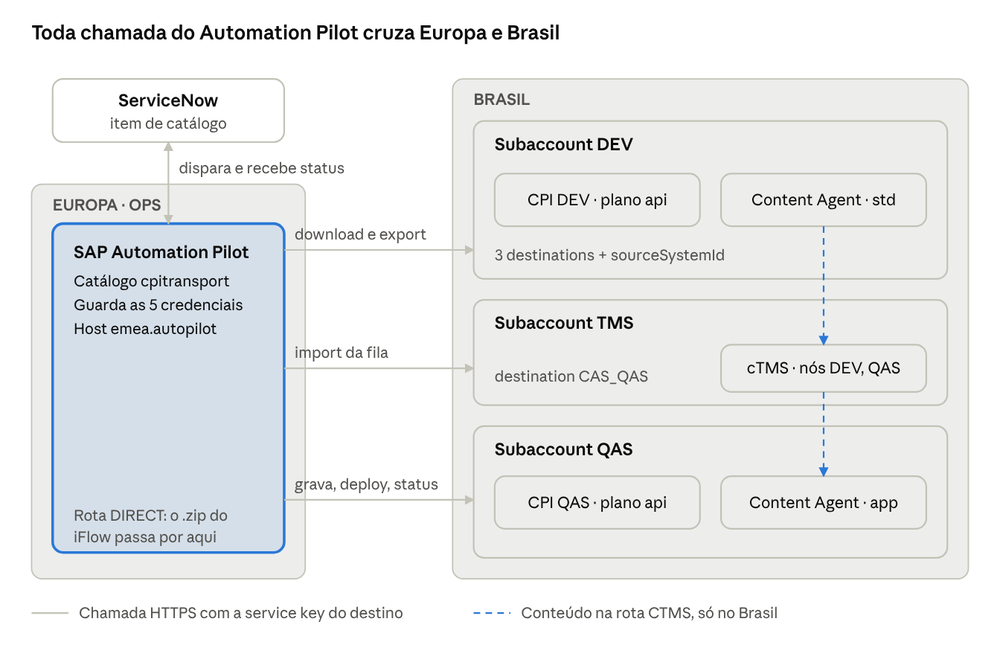
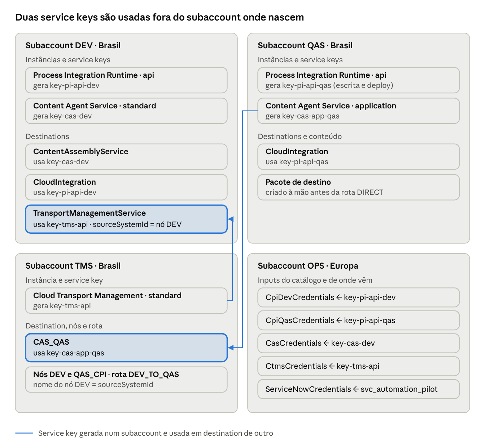
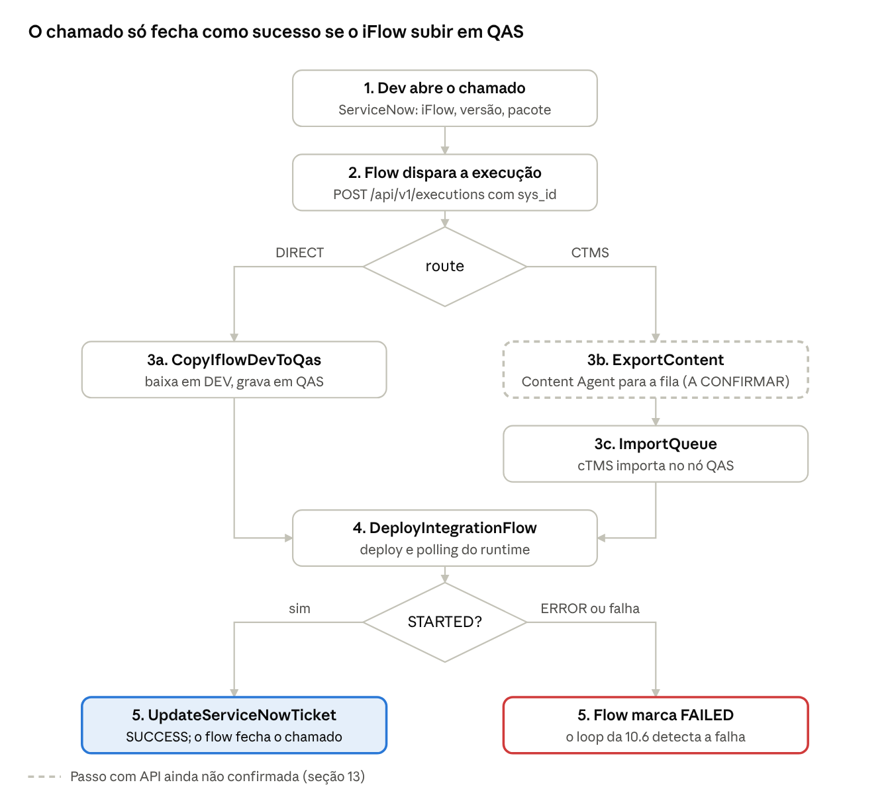

# Automação de transporte e deploy do Integration Suite com Automation Pilot

Versão de 7 de outubro de 2026 · João Pedro

> Catálogo do Automation Pilot: [`automation-pilot/cpi-transport-catalog.json`](automation-pilot/cpi-transport-catalog.json)
>
> Já usa a rota de transporte do cTMS? Veja o guia exclusivo: [`EXCLUSIVO-ROTA-DE-TRANSPORTE-CTMS.md`](EXCLUSIVO-ROTA-DE-TRANSPORTE-CTMS.md)
>
> Vai migrar do modo Transport Management Service para o Content Agent? Veja a [Migração CPI](MIGRACAO-CPI.md).

Manual de provisionamento para levar um iFlow do Cloud Integration DEV para QAS automaticamente: o desenvolvedor abre um chamado no ServiceNow, e o SAP Automation Pilot faz o transporte, o deploy e devolve o resultado ao chamado. Produção fica fora desta fase. Siga as fases 0 a 6 na ordem.

## 1. Como usar este manual

O catálogo suporta duas rotas de DEV para QAS. Comece pela **DIRECT**, que usa só APIs públicas documentadas, e ligue a **CTMS** depois de confirmar a API do Content Agent no seu tenant.

|  | Rota DIRECT | Rota CTMS |
| --- | --- | --- |
| Como o iFlow chega em QAS | Automation Pilot baixa a versão em DEV e grava em QAS pela OData API do Cloud Integration | Content Agent exporta para a fila do cTMS; cTMS importa no nó de QAS |
| Comandos do catálogo | `CopyIflowDevToQas` | `ExportContent` + `ImportQueue` |
| Controla a versão exata | Sim (`Version='1.0.3'` no download) | Depende do que o export do Content Agent aceita |
| Histórico de transporte | No chamado do ServiceNow e nas execuções do Automation Pilot | Na fila e no histórico do cTMS, além do chamado |
| Conteúdo passa pela Europa | **Sim**, o script do Automation Pilot baixa e envia o .zip | Não, o conteúdo vai DEV → cTMS → QAS, todos no Brasil |
| Status da API | APIs públicas do Cloud Integration | **Export do Content Agent não confirmado** em documentação pública |

O orquestrador `TransportToQas` recebe `route` = `DIRECT` ou `CTMS` e roda os passos certos. O resto (deploy, retorno ao chamado) é igual nas duas.

**Correção em relação à versão anterior deste documento:** a seção anterior dizia que a API de export do Content Agent estava confirmada. Não consegui confirmar isso: a documentação pública e os tutoriais da SAP fazem o export pela interface do Content Agent ou pelo botão de transporte do Integration Suite. Por isso o comando `ExportContent` vem com caminho e corpo marcados como A CONFIRMAR (ver seção 13).

Convenções usadas aqui:

- `<...>` é um valor do seu ambiente que você troca.
- **A CONFIRMAR** marca um detalhe que não consegui verificar em fonte oficial e precisa ser testado no tenant.
- Os nomes de subaccount (DEV, QAS, TMS, OPS) são rótulos; use os nomes reais do Bradesco.

## 2. Topologia cross-region

O Automation Pilot fica num subaccount na Europa e o resto (cTMS, Content Agent, Cloud Integration DEV e QAS) no Brasil. Isso funciona: o Automation Pilot chama cada serviço pela API HTTPS pública, usando a URL e o OAuth da service key, e essas APIs respondem de qualquer região.



Cada seta sólida é uma ida e volta Europa ↔ Brasil. Na rota CTMS o conteúdo do iFlow (tracejado) não sai do Brasil; na rota DIRECT ele passa pelo runtime de script do Automation Pilot na Europa.

### 2.1 Latência e os tempos escolhidos no catálogo

Cada chamada cruza o Atlântico duas vezes, e o fluxo faz dezenas delas entre tokens e polling. Por isso o catálogo troca esperas fixas curtas por polling com folga:

| Onde | Valor no catálogo | Padrão do Automation Pilot | Por quê |
| --- | --- | --- | --- |
| `timeout` dos passos HTTP de escrita (POST, PUT, PATCH) | 60 s | 5 s | Deploy e export respondem devagar; 5 s estoura com latência transatlântica |
| `timeout` dos passos HTTP de leitura (polling) | 30 s | 5 s | Margem para o token OAuth mais a resposta |
| `autoRetry` | 4 tentativas, 15 s crescentes, só em 429, 502, 503, 504 e falha de rede | Nenhum | Oscilação de rede entre regiões sem repetir erro de negócio |
| `ExportContent` → `WaitExport` | Espera inicial 30 s; depois a cada 30 s, até 30 vezes (15 min) | — | Montagem do MTAR e entrega na fila |
| `ImportQueue` → `StartImport` | Espera inicial 60 s | — | Dá tempo da request aparecer na fila depois do export |
| `ImportQueue` → `WaitImport` | 30 s, depois a cada 30 s até 30 vezes (15 min) | — | Import assíncrono do cTMS |
| `CopyIflowDevToQas` (script) | `timeout` 300 s; 2 novas tentativas a cada 30 s | 60 s | Download e upload do .zip em base64 |
| `TransportToQas` → antes do deploy | 30 s | — | QAS precisa registrar a nova versão antes do deploy |
| `DeployIntegrationFlow` → `WaitRuntime` | 1 min, depois a cada 30 s até 20 vezes (10 min); 404 aceito no início | — | O artefato só aparece em runtime alguns segundos depois do deploy |
| Loop do flow no ServiceNow (10.6) | 60 s, até 60 vezes (1 hora) | — | Cobre os cerca de 45 minutos do pior caso da rota CTMS |

As esperas (`initialDelay`, `repeat.delay`, `autoRetry.delay`) só aceitam 5s, 10s, 15s, 30s, 1m, 2m ou 3m. Ao ajustar os tempos, use só esses valores e mexa no `maxCount` para mudar o total.

No pior caso a rota CTMS soma cerca de 45 minutos antes de falhar por tempo; a DIRECT, cerca de 30 (contando as duas novas tentativas do script). Depois dos testes da Fase 6, ajuste `maxCount` pelo tempo real medido.

### 2.2 URLs por região: não misture credenciais

- As service keys do Brasil têm domínios com o código da região Brasil (por exemplo `br10` em `*.cfapps.br10.hana.ondemand.com` e `*.authentication.br10.hana.ondemand.com`).
- O Automation Pilot tem host próprio na Europa (por exemplo `emea.autopilot.cloud.sap`). Esse host só aparece no ServiceNow (10.4), nunca num input do catálogo.
- DEV e QAS têm domínios parecidos; só o subdomínio muda. Antes de salvar cada input, confira o subdomínio da `apiUrl` e do `tokenUrl` contra o subaccount de origem.
- Teste rápido: `CpiDevCredentials` e `CpiQasCredentials` nunca podem ter o mesmo `clientId`.

### 2.3 Disponibilidade do Automation Pilot

A lista de hosts do Automation Pilot nos materiais da SAP tem Europa, Américas, Ásia-Pacífico, Austrália e Arábia Saudita, e nenhum no Brasil. Vale conferir no SAP Discovery Center se o data center das Américas está disponível para a global account do Bradesco: ele reduziria a latência e talvez simplificasse a análise de compliance. Se não estiver, a Europa funciona com os tempos acima.

### 2.4 Residência de dados e compliance

Valide com Segurança da Informação e Compliance antes de ligar em QAS. Pontos para levar à conversa:

- **Credenciais na Europa:** os inputs do Automation Pilot guardam client IDs e secrets de serviços do Brasil e o usuário de integração do ServiceNow.
- **Metadados na Europa:** IDs de iFlow, versões, números de chamado, status e logs de execução ficam no histórico do Automation Pilot.
- **Conteúdo:** na rota CTMS, o Automation Pilot só orquestra; o conteúdo vai DEV → cTMS → QAS dentro do Brasil. Na rota DIRECT, o .zip do iFlow (código, mapeamentos, scripts) é processado pelo script do Automation Pilot na Europa.
- **Não tome como garantia:** que o Automation Pilot não retém o conteúdo processado precisa ser confirmado na documentação de segurança e proteção de dados da SAP para o serviço e no contrato. Este manual não afirma isso.
- **iFlows com dados sensíveis em parâmetros:** valores externalizados e credenciais ficam no CPI (Security Material), não no .zip, se o desenvolvimento seguir o padrão. Vale confirmar que nenhum iFlow tem segredo embutido.

Se o compliance vetar conteúdo na Europa, fique na rota CTMS ou mova o Automation Pilot para um data center aprovado.

## 3. Arquitetura de provisionamento

São quatro subaccounts, seis service keys e cinco destinations. O diagrama mostra onde cada key nasce e onde ela é usada; as fases 1 a 4 criam tudo na ordem certa.



As duas setas são as dependências que mais travam o provisionamento: a destination `TransportManagementService` do DEV só fica pronta depois da key do cTMS (Fase 3), e a destination `CAS_QAS` do cTMS só depois da key do Content Agent de QAS (Fase 2). Ambas existem só na rota CTMS; a rota DIRECT precisa apenas das duas keys do plano `api` e dos inputs do Automation Pilot.

## 4. Fluxo ponta a ponta

O desenvolvedor só abre o chamado. Ninguém clica em **Transport** no Integration Suite nem entra no cTMS.



A falha em qualquer passo do Automation Pilot vira `FAILED` no chamado pelo loop de acompanhamento do flow (10.6), mesmo quando o Automation Pilot não chega a escrever no ServiceNow.

## 5. Fase 0 — Entitlements, papéis e ordem

Libere as entitlements antes de criar qualquer instância. Como Global Account Administrator, faça em cada subaccount: **Entitlements → Edit → Add Service Plans**.

| Subaccount | Região | Serviço | Plano | Rota | Para quê |
| --- | --- | --- | --- | --- | --- |
| DEV | Brasil | Process Integration Runtime | `api` | DIRECT | Client OAuth para baixar o iFlow de DEV |
| DEV | Brasil | Content Agent Service | `standard` | CTMS | Montar o conteúdo (assembly) e exportar para o cTMS |
| DEV | Brasil | Content Agent Service | `application` | CTMS | UI do Content Agent (opcional, útil para testar o export à mão) |
| QAS | Brasil | Process Integration Runtime | `api` | Ambas | Client OAuth para gravar, configurar e fazer deploy em QAS |
| QAS | Brasil | Content Agent Service | `application` | CTMS | Receber o import vindo do cTMS |
| TMS (central) | Brasil | Cloud Transport Management | `standard` (instância) e `lite` (aplicação) | CTMS | Fila, nós e rota; o plano `standard` dá acesso total à API |
| OPS | Europa | SAP Automation Pilot | `standard` | Ambas | Orquestrar o fluxo |

No cTMS, não use o plano `transport_operator` para a service key do Automation Pilot: ele só importa, reseta, encaminha e apaga. O plano `standard` cobre tudo, e o `export` só exporta.

Role collections a atribuir:

| Onde | Role collection | Quem recebe |
| --- | --- | --- |
| DEV e QAS | `Integration_Provisioner` | Você, para ativar o Integration Suite e criar as instâncias de runtime |
| DEV | Role com `WorkspacePackagesTransport` | Quem ainda for transportar à mão (o fluxo automático não precisa) |
| TMS | Role com o template `Administrator` do cTMS | Você, para criar nós e rotas |
| OPS | `AutomationPilot_Developer` (ou equivalente do seu tenant) | Você, para importar o catálogo e criar o service account |

Ordem de provisionamento (cada fase depende da anterior):

1. Fase 1 — DEV: instâncias e destinations.
2. Fase 2 — QAS: instâncias e destination.
3. Fase 3 — cTMS: nós e rota (só rota CTMS).
4. Fase 4 — Automation Pilot: catálogo e inputs com as service keys das fases 1 a 3.
5. Fase 5 — ServiceNow: formulário e flow, com o service account da fase 4.
6. Fase 6 — Testes.

Antes de começar, junte numa planilha segura (nunca no chamado, nunca em e-mail): cada service key gerada, o subaccount de origem e a região. Isso evita o erro mais comum deste cenário, que é colar a credencial de um ambiente no input de outro.

## 6. Fase 1 — Subaccount DEV

No DEV você cria até duas instâncias e três destinations. Os passos 1 e 2 servem à rota DIRECT; os passos 3 a 7, à rota CTMS.

### 6.1 Process Integration Runtime, plano api (rota DIRECT)

1. **Services → Instances and Subscriptions → Create**. Serviço `Process Integration Runtime`, plano `api`, nome `pi-api-dev`.
2. Em **Parameters**, grant type `client_credentials` e a role `WorkspacePackagesRead`. `WorkspacePackagesRead` basta para baixar o iFlow; não dê permissões de escrita em DEV.
3. Na instância: **Create Service Key** → `key-pi-api-dev`. Guarde `url`, `tokenurl`, `clientid`, `clientsecret`. Eles vão para o input `CpiDevCredentials`.

JSON de parâmetros, se preferir colar em vez de marcar na tela (nomes das roles A CONFIRMAR na lista de roles do seu tenant):

```json
{
  "grant-types": ["client_credentials"],
  "roles": ["WorkspacePackagesRead"]
}
```

### 6.2 Content Agent Service, plano standard (rota CTMS)

1. **Create** → serviço `Content Agent Service`, plano `standard`, nome `cas-dev`.
2. **Create Service Key** → `key-cas-dev`. Guarde a URL da API e o bloco `uaa` (`url`, `clientid`, `clientsecret`). Eles alimentam a destination do passo 6.3 e o input `CasCredentials`.

### 6.3 Destination de Content Assembly

**Connectivity → Destinations → New Destination**:

| Campo | Valor |
| --- | --- |
| Name | `ContentAssemblyService` (nome fixo) |
| Type | HTTP |
| URL | URL da service key `key-cas-dev` |
| Proxy Type | Internet |
| Authentication | OAuth2ClientCredentials |
| Client ID / Secret | `uaa.clientid` / `uaa.clientsecret` da `key-cas-dev` |
| Token Service URL | `uaa.url` + `/oauth/token` |

No **Check Connection**, um `401 Unauthorized` é esperado para essa destination e não indica erro.

### 6.4 Destination CloudIntegration

O Content Agent usa essa destination para ler o conteúdo do CPI DEV.

| Campo | Valor |
| --- | --- |
| Name | `CloudIntegration` (nome fixo) |
| Type | HTTP |
| URL | `url` da `key-pi-api-dev` |
| Authentication | OAuth2ClientCredentials |
| Client ID / Secret / Token Service URL | Da `key-pi-api-dev` |

Para essa destination, o client do plano `api` precisa da role `WorkspacePackagesTransport` além de `WorkspacePackagesRead`. Se usar a rota CTMS, adicione-a na instância `pi-api-dev` (Update → Parameters).

### 6.5 Destination TransportManagementService

Faz o export cair na fila do cTMS. Use a service key do cTMS criada na Fase 3 (volte aqui depois de criá-la).

| Campo | Valor |
| --- | --- |
| Name | `TransportManagementService` (nome fixo para Cloud Integration) |
| Type | HTTP |
| URL | `uri` da service key do cTMS |
| Proxy Type | Internet |
| Authentication | OAuth2ClientCredentials |
| Client ID / Secret | `uaa.clientid` / `uaa.clientsecret` |
| Token Service URL Type | Dedicated |
| Token Service URL | `uaa.url` + `/oauth/token` |
| Additional property | `sourceSystemId` = `<NOME_DO_NO_DEV>` |

**O `sourceSystemId` precisa ser idêntico ao nome do nó de origem no cTMS**, com maiúsculas e minúsculas. Se o nó se chama `DEV_CPI`, a propriedade é `DEV_CPI`. Diferença de uma letra faz o export sair com sucesso e nunca aparecer na fila.

### 6.6 Ativar o transporte no Integration Suite DEV

1. Abra o Integration Suite DEV → **Settings → Integrations → Transport → Edit**.
2. Escolha **Transport Management Service** e salve.
3. **Check Configuration** deve mostrar sucesso e o nó DEV alcançável.

### 6.7 Teste manual de referência

Antes de automatizar, transporte um iFlow de teste à mão (botão **Transport** no pacote) e confirme que a request aparece na fila de QAS. Esse teste prova que as destinations e o `sourceSystemId` estão certos.

## 7. Fase 2 — Subaccount QAS

QAS é onde o Automation Pilot grava, configura e faz deploy. A instância do plano `api` aqui precisa de escrita.

### 7.1 Process Integration Runtime, plano api (ambas as rotas)

1. **Create** → `Process Integration Runtime`, plano `api`, nome `pi-api-qas`.
2. Grant type `client_credentials`. Roles: `WorkspacePackagesRead`, `WorkspacePackagesEdit`, `WorkspacePackagesConfigure`, `WorkspaceArtifactsDeploy`, `MonitoringDataRead`.
3. **Create Service Key** → `key-pi-api-qas`. Guarde `url`, `tokenurl`, `clientid`, `clientsecret` para o input `CpiQasCredentials`.

```json
{
  "grant-types": ["client_credentials"],
  "roles": [
    "WorkspacePackagesRead",
    "WorkspacePackagesEdit",
    "WorkspacePackagesConfigure",
    "WorkspaceArtifactsDeploy",
    "MonitoringDataRead"
  ]
}
```

Para que serve cada role:

- `WorkspacePackagesEdit` — criar ou atualizar o iFlow em QAS (rota DIRECT).
- `WorkspacePackagesConfigure` — alterar parâmetros externalizados.
- `WorkspaceArtifactsDeploy` — fazer deploy.
- `MonitoringDataRead` — ler o status em runtime depois do deploy.

### 7.2 Pacote de destino

A rota DIRECT grava o iFlow dentro de um pacote que **precisa existir** em QAS. Crie o pacote em QAS com o mesmo ID técnico do pacote em DEV antes do primeiro transporte. A rota CTMS cria o pacote sozinha no import.

### 7.3 Content Agent Service, plano application (rota CTMS)

1. **Create** → `Content Agent Service`, plano `application`, nome `cas-app-qas`, com a role de import selecionada.
2. **Create Service Key** → `key-cas-app-qas`. Ela alimenta a destination do nó QAS no cTMS (Fase 3).

### 7.4 Destination CloudIntegration em QAS (rota CTMS)

Mesmo formato da 6.4, mas com a `key-pi-api-qas`. O Content Agent de QAS usa essa destination para gravar o conteúdo importado no CPI QAS.

| Campo | Valor |
| --- | --- |
| Name | `CloudIntegration` |
| URL | `url` da `key-pi-api-qas` |
| Authentication | OAuth2ClientCredentials |
| Client ID / Secret / Token Service URL | Da `key-pi-api-qas` |

## 8. Fase 3 — cTMS (só rota CTMS)

Você já tem o subaccount do cTMS no Brasil. Falta a service key para as APIs, uma destination para o nó QAS, os nós e a rota.

### 8.1 Service key para APIs

1. No subaccount TMS: **Create** → `Cloud Transport Management`, plano `standard`, nome `tms-api`.
2. **Create Service Key** → `key-tms-api`. Guarde `uri` e o bloco `uaa` (`url`, `clientid`, `clientsecret`).
3. Essa key alimenta a destination `TransportManagementService` do DEV (volte à 6.5) e o input `CtmsCredentials`.

### 8.2 Destination para o nó QAS

No subaccount TMS, **Connectivity → Destinations → New**. O cTMS usa essa destination para entregar o conteúdo ao Content Agent de QAS.

| Campo | Valor |
| --- | --- |
| Name | `CAS_QAS` (livre; você escolhe) |
| Type | HTTP |
| URL | URL da `key-cas-app-qas` (7.3) |
| Proxy Type | Internet |
| Authentication | OAuth2ClientCredentials |
| Client ID / Secret | Da `key-cas-app-qas` |
| Token Service URL | `uaa.url` da `key-cas-app-qas` + `/oauth/token` |

### 8.3 Nós e rota

Na aplicação do cTMS → **Transport Nodes → +**:

| Nó | Allow Upload to Node | Forward Mode | Content Type | Destination |
| --- | --- | --- | --- | --- |
| `<NOME_DO_NO_DEV>` (igual ao `sourceSystemId`) | Sim | Auto | Multi-Target Application | Nenhuma (nó de origem) |
| `QAS_CPI` | Não | Auto | Multi-Target Application | `CAS_QAS` |

Depois, **Transport Routes → +**: rota `DEV_TO_QAS`, origem o nó DEV, destino `QAS_CPI`.

Os valores de Forward Mode e Content Type da tabela seguem o padrão dos tutoriais do Content Agent; confira na tela do seu cTMS, que pode mostrar rótulos diferentes.

### 8.4 Pegue o ID numérico do nó QAS

O comando `ImportQueue` pede o ID numérico, não o nome. Pegue-o com a API:

```bash
TOKEN=$(curl -s -u "$CLIENT_ID:$CLIENT_SECRET" \
  -d grant_type=client_credentials "$UAA_URL/oauth/token" | jq -r .access_token)
curl -s -H "Authorization: Bearer $TOKEN" "$TMS_URI/v2/nodes" | jq '.[] | {id, name}'
```

Anote o `id` do `QAS_CPI`; ele vai no campo `qasNodeId` do chamado (ou fica fixo no flow do ServiceNow).

## 9. Fase 4 — Automation Pilot (subaccount OPS, Europa)

### 9.1 Assinatura e acesso

1. No subaccount OPS: **Instances and Subscriptions → Create** → `Automation Pilot`, plano `standard` (subscription).
2. Atribua a si mesmo a role collection de desenvolvedor do Automation Pilot e abra a aplicação.
3. Anote o host do seu tenant (por exemplo `emea.autopilot.cloud.sap`). Ele vira a base da URL que o ServiceNow chama.

### 9.2 Importar o catálogo

1. **My Catalogs → Import**.
2. Cole o conteúdo inteiro do `cpi-transport-catalog.json` e confirme.
3. O marcador `<<<TENANT_ID>>>` nos IDs é o mesmo usado nos exemplos oficiais da SAP e é trocado pelo ID do seu tenant na importação.
4. Aparece o catálogo **CPI Transport DEV to QAS** com 8 comandos e 5 inputs.

| Comando | Rota | O que faz |
| --- | --- | --- |
| `TransportToQas` | Ambas | Orquestrador chamado pelo ServiceNow |
| `CopyIflowDevToQas` | DIRECT | Script Python: baixa a versão em DEV e cria ou atualiza o iFlow em QAS |
| `ExportContent` | CTMS | Cria a operação de export no Content Agent e espera concluir (**A CONFIRMAR**) |
| `ImportQueue` | CTMS | Importa a fila do nó QAS e espera a ação do cTMS |
| `DeployIntegrationFlow` | Ambas | Deploy em QAS e polling até `STARTED` ou `ERROR` |
| `SetExternalizedParameter` | Ambas | Muda um parâmetro externalizado (uso avulso) |
| `UpdateServiceNowTicket` | Ambas | PATCH no chamado pela Table API |
| `ReportFailureToServiceNow` | Ambas | Grava a falha no chamado |

### 9.3 Preencher os inputs

Abra cada input → **Edit** e cole os valores. Os campos de secret já vêm marcados como sensíveis e não aparecem em logs.

| Input | Vem de | Campos | Domínio esperado |
| --- | --- | --- | --- |
| `CpiDevCredentials` | `key-pi-api-dev` (6.1) | `apiUrl`, `tokenUrl`, `clientId`, `clientSecret` | Brasil (`br10` ou o da sua região) |
| `CpiQasCredentials` | `key-pi-api-qas` (7.1) | Idem | Brasil |
| `CasCredentials` | `key-cas-dev` (6.2) | `url`, `tokenUrl`, `clientId`, `clientSecret` | Brasil |
| `CtmsCredentials` | `key-tms-api` (8.1) | `uri`, `tokenUrl`, `clientId`, `clientSecret` | Brasil |
| `ServiceNowCredentials` | Usuário de integração (10.2) | `instanceUrl`, `user`, `password` | `*.service-now.com` |

Atenção ao `tokenUrl`: no plano `api` do CPI ele já vem pronto (`tokenurl`); no cTMS e no Content Agent você monta `uaa.url` + `/oauth/token`.

### 9.4 Service account para o ServiceNow

O ServiceNow precisa de uma credencial própria para chamar a API de execuções.

1. No Automation Pilot, abra a área de **Service Accounts** (o rótulo pode variar por versão) e crie `servicenow-trigger` com autenticação Basic.
2. Dê a ele só a permissão de disparar execuções do catálogo `cpitrans`, se o tenant permitir esse recorte.
3. Guarde usuário e senha; eles vão para o Credential Alias do ServiceNow (10.4).

A API de disparo:

```bash
curl -s -X POST -u "$AP_USER:$AP_PASSWORD" \
  -H "Content-Type: application/json" \
  -d '{
    "commandId": "cpitrans-<TENANT_ID>:TransportToQas:1",
    "inputValues": {
      "artifactId": "IF_Pedidos_SAP_para_Banco",
      "version": "1.0.3",
      "packageId": "PKG_PEDIDOS",
      "route": "DIRECT",
      "ticketNumber": "RITM0012345",
      "ticketSysId": "<sys_id>",
      "ticketTable": "sc_req_item"
    },
    "tags": {"feature:logs": ""}
  }' \
  "https://emea.autopilot.cloud.sap/api/v1/executions"
```

Todo valor em `inputValues` vai como texto, inclusive números. A tag `feature:logs` liga os logs da execução e só vale se for mandada no disparo. A resposta traz o `id` da execução, que o ServiceNow guarda para acompanhar.

### 9.5 Ajustes que você provavelmente fará

- **Campo de status no ServiceNow:** `UpdateServiceNowTicket` grava em `u_cpi_transport_status` e `work_notes`. Troque pelo nome do campo que você criar (10.3).
- **Release dos comandos:** comandos importados ficam em rascunho. Só libere depois que os testes da Fase 6 passarem.
- **Rota padrão:** `TransportToQas` usa `DIRECT` por padrão. Mude o `defaultValue` de `route` quando a rota CTMS estiver validada.

## 10. Fase 5 — ServiceNow

O desenvolvedor preenche um item de catálogo; um flow do Flow Designer dispara o Automation Pilot, acompanha a execução e fecha o chamado. São duas APIs: **saída** pela REST step do Integration Hub (ServiceNow → Automation Pilot) e **retorno** pela Table API (Automation Pilot → ServiceNow).

### 10.1 Item de catálogo e campos

**Service Catalog → Maintain Items → New**: nome `Transporte CPI DEV → QAS`, categoria `Integrações`. Crie as variáveis:

| Variável (name) | Rótulo para o dev | Tipo | Obrigatória | Exemplo | Vira no Automation Pilot |
| --- | --- | --- | --- | --- | --- |
| `u_artifact_id` | ID técnico do iFlow | Single Line Text | Sim | `IF_Pedidos_SAP_para_Banco` | `artifactId` |
| `u_artifact_version` | Versão em DEV | Single Line Text | Sim | `1.0.3` | `version` |
| `u_package_id` | ID técnico do pacote | Single Line Text | Sim | `PKG_PEDIDOS` | `packageId` |
| `u_target_env` | Ambiente de destino | Select Box, read-only | Sim | `QAS` (único valor) | Informativo |
| `u_justification` | Justificativa da mudança | Multi Line Text | Sim | `Correção do mapeamento de CNPJ` | Vai para o chamado |
| `u_change_reference` | Mudança ou história relacionada | Single Line Text | Não | `CHG0045678` | Vai para o chamado |

Validações que evitam chamado inválido (use **Variable Validation Regex**):

- `u_artifact_id`: `^[A-Za-z0-9_.-]+$` — o ID técnico, nunca o nome de exibição com espaços.
- `u_artifact_version`: `^(\d+\.\d+\.\d+|active)$` — uma versão salva (`1.0.3`) ou `active` (a versão atual em DEV). Prefira o número: ele fica registrado no chamado e a auditoria sabe exatamente o que subiu. `Draft` não é aceito.
- `u_package_id`: `^[A-Za-z0-9_.-]+$`.

O `route` e o `ticketTable` não aparecem para o dev: ficam fixos no flow (`DIRECT` e `sc_req_item`).

No help text do item, diga onde achar os dados: no Integration Suite DEV, abra o iFlow → aba de versões para a versão, e o ID técnico em **Integration Flow → Technical Name**.

### 10.2 Usuário de integração (retorno do Automation Pilot)

1. **User Administration → Users → New**: `svc_automation_pilot`, marque **Web service access only**, defina senha.
2. Dê a ele um papel que permita atualizar `sc_req_item` pela Table API. Prefira um papel próprio com ACL de write só nos campos `u_cpi_transport_status` e `work_notes`, em vez de `admin`. O papel exato depende das ACLs da sua instância: valide com o admin do ServiceNow.
3. Esses dados vão para o input `ServiceNowCredentials` do Automation Pilot.

### 10.3 Campos novos no Requested Item

Em `sc_req_item` (**System Definition → Tables**), crie:

| Campo | Tipo | Valores | Quem grava |
| --- | --- | --- | --- |
| `u_cpi_transport_status` | Choice | `PENDING`, `RUNNING`, `SUCCESS`, `FAILED` | Flow e Automation Pilot |
| `u_ap_execution_id` | String (100) | ID da execução | Flow |

### 10.4 Credencial e conexão para o Automation Pilot

Nunca coloque a senha no flow. Use o cofre do ServiceNow:

1. **Connections & Credentials → Credentials → New → Basic Auth Credentials**: nome `AutomationPilot_Trigger`, usuário e senha do service account da 9.4.
2. **Connections & Credentials → Connection & Credential Aliases → New**: nome `AutomationPilot`, type `Connection and Credential`.
3. No alias, **Connections → New → HTTP(s) Connection**: credential `AutomationPilot_Trigger`, Connection URL `https://emea.autopilot.cloud.sap` (o host do seu tenant).

### 10.5 Action “Disparar Automation Pilot”

**Flow Designer → New → Action** `Disparar Automation Pilot`, com inputs `artifact_id`, `version`, `package_id`, `ticket_number`, `ticket_sys_id`.

REST step (exige Integration Hub; confirme o licenciamento):

| Campo | Valor |
| --- | --- |
| Connection | Use Connection Alias → `AutomationPilot` |
| Resource Path | `/api/v1/executions` |
| HTTP Method | POST |
| Headers | `Content-Type: application/json`, `Accept: application/json` |
| Request Body | O JSON abaixo, com os data pills nos lugares de `{{...}}` |

```json
{
  "commandId": "cpitrans-<TENANT_ID>:TransportToQas:1",
  "inputValues": {
    "artifactId": "{{artifact_id}}",
    "version": "{{version}}",
    "packageId": "{{package_id}}",
    "route": "DIRECT",
    "ticketNumber": "{{ticket_number}}",
    "ticketSysId": "{{ticket_sys_id}}",
    "ticketTable": "sc_req_item"
  },
  "tags": {"feature:logs": "", "servicenow:ticket": "{{ticket_number}}"}
}
```

Depois da REST step, um Script step extrai o ID da execução:

```javascript
(function execute(inputs, outputs) {
  var body = JSON.parse(inputs.response_body);
  outputs.execution_id = body.id;
})(inputs, outputs);
```

Outputs da action: `status_code` e `execution_id`.

Crie uma segunda action, `Consultar execução`, igual mas com GET em `/api/v1/executions/{{execution_id}}` e output `execution_status` = `body.status` (`RUNNING`, `FINISHED`, `FAILED`, `ABORTED`, `SUSPENDED`).

### 10.6 Flow “Transporte CPI para QAS”

**Flow Designer → New → Flow**, Run As **System User**. Trigger: **Service Catalog**. No item de catálogo (10.1), campo **Flow**, selecione este flow.

1. **Get Catalog Variables** — Submitted Request = Trigger → Requested Item; marque as variáveis da 10.1.
2. **Update Record** (Requested Item) — `u_cpi_transport_status` = `RUNNING`.
3. **Disparar Automation Pilot** — mapeie as variáveis; `ticket_number` = Requested Item → Number; `ticket_sys_id` = Requested Item → Sys ID.
4. **If** `status_code` diferente de 201 e de 200 → Update Record `u_cpi_transport_status` = `FAILED`, work notes com o código, e **End Flow**.
5. **Update Record** — `u_ap_execution_id` = `execution_id`.
6. **Do the following until** `execution_status` for `FINISHED`, `FAILED`, `ABORTED` ou `SUSPENDED`, no máximo 60 vezes:
   1. **Wait for a duration**: 60 segundos.
   2. **Consultar execução**.
7. **If** `execution_status` = `FINISHED` → Update Record State = Closed Complete. O Automation Pilot já gravou `SUCCESS` e as work notes.
8. **Else** → Update Record `u_cpi_transport_status` = `FAILED`, work notes `Execução {{execution_id}} terminou em {{execution_status}}. Ver Automation Pilot.`, e atribua ao grupo de suporte de integração.
9. **Activate** (publicar). Em rascunho o flow não dispara.

O passo 6 cobre o caso em que o Automation Pilot falha antes de conseguir escrever no chamado. Sessenta voltas de 60 s cobrem o pior caso dos timeouts cross-region da seção 2 (cerca de 45 minutos na rota CTMS).

### 10.7 O que o Automation Pilot manda de volta

`UpdateServiceNowTicket` faz esta chamada (Table API):

```http
PATCH https://<instancia>.service-now.com/api/now/table/sc_req_item/<sys_id>
Authorization: Basic <svc_automation_pilot>
Content-Type: application/json

{
  "u_cpi_transport_status": "SUCCESS",
  "work_notes": "Automation Pilot: iFlow IF_Pedidos_SAP_para_Banco v1.0.3 em QAS com status STARTED (rota DIRECT)."
}
```

O `sys_id` é a chave de correlação: o flow manda no disparo e o Automation Pilot devolve no PATCH. O número do chamado vai junto como `ticketNumber` e como tag da execução, para busca no Automation Pilot.

### 10.8 Referência de nomes ponta a ponta

Use os mesmos nomes do formulário até a payload. O orquestrador chama-se `TransportToQas` (era `ImportAndDeploy` nas versões anteriores deste documento) e começa por `ExportContent` na rota CTMS ou por `CopyIflowDevToQas` na DIRECT.

| Campo no chamado (`sc_req_item`) | Data pill no flow | Chave em `inputValues` | Uso no Automation Pilot |
| --- | --- | --- | --- |
| `u_artifact_id` | `artifact_id` | `artifactId` | iFlow a baixar, gravar e implantar |
| `u_artifact_version` | `version` | `version` | Versão baixada em DEV |
| `u_package_id` | `package_id` | `packageId` | Pacote em QAS (criação do iFlow) |
| `u_target_env` | — | — | Informativo; sempre QAS nesta fase |
| Fixo no flow | — | `route` | `DIRECT` ou `CTMS` |
| Fixo no flow (só CTMS) | — | `qasNodeId` | ID numérico do nó QAS no cTMS (8.4) |
| Number (ex.: `RITM0012345`) | `ticket_number` | `ticketNumber` | **correlationId**: work notes e tag da execução |
| Sys ID | `ticket_sys_id` | `ticketSysId` | Chave do PATCH de volta |
| — | — | `ticketTable` | `sc_req_item` |
| `u_justification`, `u_change_reference` | — | — | Ficam só no chamado, para auditoria |
| `u_cpi_transport_status` | — | — | Gravado pelo flow (`RUNNING`, `FAILED`) e pelo Automation Pilot (`SUCCESS`) |
| `u_ap_execution_id` | `execution_id` | — | Gravado pelo flow com o ID da execução |

**Por que o Package ID é obrigatório.** Na rota DIRECT ele é o pacote onde o iFlow é criado em QAS no primeiro transporte. Transportar o pacote inteiro de uma vez não está no catálogo desta fase: hoje é um chamado por iFlow. Se quiser o pacote inteiro, o caminho é um `ForEach` sobre os iFlows do pacote, numa próxima versão.

**Corpo do POST na rota CTMS** (o da 10.5 é o da DIRECT):

```json
{
  "commandId": "cpitrans-<TENANT_ID>:TransportToQas:1",
  "inputValues": {
    "artifactId": "{{artifact_id}}",
    "version": "{{version}}",
    "packageId": "{{package_id}}",
    "route": "CTMS",
    "qasNodeId": "<ID_DO_NO_QAS>",
    "ticketNumber": "{{ticket_number}}",
    "ticketSysId": "{{ticket_sys_id}}",
    "ticketTable": "sc_req_item"
  },
  "tags": {"feature:logs": "", "servicenow:ticket": "{{ticket_number}}"}
}
```

**Quem muda o `state` do chamado.** O Automation Pilot grava só o resultado (`u_cpi_transport_status` e work notes). O flow muda o `state` (Closed Complete ou atribuição ao suporte), porque o estado do Requested Item segue o processo do catálogo e mexer nele de fora pode furar regras de negócio. Se mesmo assim quiser que o Automation Pilot feche o chamado, acrescente ao corpo do PATCH `"state": "3"` (Closed Complete no padrão; confira o valor na sua instância) e dê ao usuário de integração write em `state`.

**Achar o chamado pelo número em vez do sys\_id.** O catálogo usa o `sys_id` porque ele vai direto na URL do PATCH. Se o seu padrão for correlacionar só pelo número, são duas chamadas da Table API:

```http
GET https://<instancia>.service-now.com/api/now/table/sc_req_item?sysparm_query=number=RITM0012345&sysparm_fields=sys_id,number,state
Authorization: Basic <svc_automation_pilot>
Accept: application/json
```

Depois, o PATCH da 10.7 com o `sys_id` que voltou em `result[0].sys_id`.

**Gatilho alternativo: Record Created.** O gatilho **Service Catalog** (10.6) já dispara só para o item ao qual o flow está ligado. Se a sua governança preferir um gatilho de tabela, use **Created** em `sc_req_item` com a condição **Item is Transporte CPI DEV → QAS**. Sem essa condição, o flow dispararia em todo Requested Item da instância.

**OAuth em vez de Basic para chamar o Automation Pilot.** O catálogo assume um service account Basic, que é o que os exemplos da SAP usam na API de execuções. Se o seu tenant oferecer service account OAuth (confirme na tela da 9.4):

1. Em **Connections & Credentials → Credentials**, crie uma credencial **OAuth 2.0** ligada a um **Application Registry** do tipo “Connect to a third party OAuth Provider”, com grant type Client Credentials, client ID, secret e token URL do service account.
2. Use essa credencial no alias `AutomationPilot` no lugar da Basic.
3. A REST step pede e renova o token sozinha a cada chamada. Não crie um passo separado de token nem guarde o token em variável do flow.

Se precisar testar o token à mão, o pedido é o padrão client credentials:

```http
POST <token_url_do_service_account>
Authorization: Basic base64(<client_id>:<client_secret>)
Content-Type: application/x-www-form-urlencoded

grant_type=client_credentials
```

**Avisos que mais travam.** O flow só dispara depois de **Activate**; em rascunho não acontece nada. A REST step precisa do Integration Hub ativo, e só admins do Flow Designer e de conexões executam flows com ela. Nenhuma senha, secret ou token vai no corpo do flow ou em variável de catálogo: tudo fica no Connection & Credential Alias.

Documentação ServiceNow:

- [Integration steps (REST step)](https://www.servicenow.com/docs/r/zurich/integrate-applications/integration-hub/integration-steps.html) — REST step, alias recomendado em vez de conexão inline
- [Table API](https://www.servicenow.com/docs/r/api-reference/rest-apis/c_TableAPI.html) — `PATCH /api/now/table/{tableName}/{sys_id}` e `GET` com `sysparm_query`
- [Explore credentials, connections, and aliases](https://www.servicenow.com/docs/bundle/zurich-platform-security/page/product/credentials/concept/credentials-connections-alias.html)
- [Create a flow with a Service Catalog trigger](https://www.servicenow.com/docs/r/_A8eB9dICHgT30Ika3FySg/tgJkP05x5w7st39BDuDtpQ)
- [Get Catalog Variables action](https://www.servicenow.com/docs/r/QG7EzyJSIJf6bo5K1OVTbw/Xhk6zUhQJ6hm_iaMLoZ9hw)

## 11. Fase 6 — Roteiro de testes

Teste de baixo para cima: credencial, comando isolado, orquestrador, ServiceNow. Use um iFlow de teste sem efeito colateral (por exemplo, um timer que só grava log) e um pacote de teste.

**Etapa A — credenciais, fora do Automation Pilot (Postman ou curl)**

- [ ] Token do `key-pi-api-dev` e `GET {url}/api/v1/IntegrationPackages` em DEV devolve 200
- [ ] Token do `key-pi-api-qas` e o mesmo GET em QAS devolve 200
- [ ] `GET {url}/api/v1/IntegrationDesigntimeArtifacts(Id='<iflow>',Version='<versao>')/$value` em DEV baixa um .zip
- [ ] Token do `key-tms-api` e `GET {uri}/v2/nodes` lista os nós (rota CTMS)
- [ ] `PATCH` da 10.7 com o `svc_automation_pilot` atualiza um chamado de teste

**Etapa B — comandos isolados, no Automation Pilot (Trigger manual)**

- [ ] `CopyIflowDevToQas` com um iFlow que ainda não existe em QAS → saída `OK CREATE`
- [ ] `CopyIflowDevToQas` de novo, com versão maior → saída `OK UPDATE`
- [ ] `DeployIntegrationFlow` → `runtimeStatus` = `STARTED`
- [ ] `DeployIntegrationFlow` num iFlow com erro proposital (endpoint inválido) → execução falha com a mensagem `ficou em ERROR em QAS`
- [ ] `UpdateServiceNowTicket` num chamado de teste → `httpStatus` = 200
- [ ] Rota CTMS: `ImportQueue` com fila vazia → anote o que o cTMS devolve e ajuste o `validate` se for erro
- [ ] Rota CTMS: `ExportContent` só depois de ajustar `exportPath`, `statusPath` e o corpo (seção 13)

**Etapa C — orquestrador**

- [ ] `TransportToQas` com `route` = `DIRECT` e um chamado de teste → execução `FINISHED` e chamado com `SUCCESS`
- [ ] Mesmo teste com versão inexistente → execução `FAILED` no passo `Copy` com `ERRO_DOWNLOAD_DEV 404`
- [ ] Tempo total anotado (base para ajustar timeouts, seção 2)

**Etapa D — ponta a ponta pelo ServiceNow**

- [ ] Dev abre o item pelo portal → `u_cpi_transport_status` vai para `RUNNING` e `u_ap_execution_id` é preenchido
- [ ] iFlow aparece em QAS com a versão pedida e status `Started` no monitor
- [ ] Chamado fecha como Closed Complete com work notes do Automation Pilot
- [ ] Chamado com versão errada → chamado em `FAILED` e atribuído ao grupo de suporte

Só libere (release) os comandos e abra o item de catálogo para os devs depois que a Etapa D passar inteira.

## 12. Troubleshooting

Abra a execução no Automation Pilot, ache o passo em vermelho e leia `status` e `body` da saída. A tabela cobre os casos mais comuns.

| Sintoma | Causa provável | Correção |
| --- | --- | --- |
| `401` em qualquer passo | Token não gerado: `tokenUrl` errado (faltou `/oauth/token`), secret trocado, ou credencial de outro ambiente | Refaça o teste da Etapa A com a mesma key; confira o domínio da URL (seção 2) |
| `403` no CPI | O client do plano `api` não tem a role do passo | Deploy: `WorkspaceArtifactsDeploy`; parâmetro: `WorkspacePackagesConfigure`; gravar iFlow: `WorkspacePackagesEdit`; status: `MonitoringDataRead`. Atualize a instância e gere nova key |
| `403` no cTMS | Service key de plano `transport_operator` ou `export` | Gere a key a partir de instância plano `standard` |
| `400` ou `404` no deploy ou na URL com `Id='...'` | Aspas simples sem codificação, ou ID de exibição em vez do técnico | O catálogo já usa `%27`; confira se o dev mandou o Technical Name |
| `ERRO_DOWNLOAD_DEV 404` | Versão não existe ou não foi salva como versão | Peça ao dev para salvar como versão no DEV e reabrir o chamado |
| `ERRO_UPLOAD_QAS ... CREATE 4xx` | Pacote não existe em QAS | Crie o pacote em QAS (7.2) |
| Import do cTMS sem nada para importar | Fila vazia: o export não chegou, ou `sourceSystemId` diferente do nome do nó | Confira a fila de QAS; compare `sourceSystemId` letra por letra com o nome do nó |
| Export “ok” mas request não aparece no cTMS | `sourceSystemId` ou destination `TransportManagementService` errados | Refaça a 6.5 e o teste manual 6.7 |
| `WaitRuntime` esgota as 30 tentativas | Deploy lento (iFlow grande, tenant ocupado, latência) | Veja o Monitor do QAS; se estiver `Starting`, aumente `maxCount` (seção 2) |
| Status `ERROR` em runtime | Erro de configuração do iFlow em QAS (credencial, endpoint) | Ajuste no QAS ou rode `SetExternalizedParameter` e refaça o deploy |
| Passo HTTP falha por timeout | Chamada passou de 60 s | O `autoRetry` já tenta de novo em 429/502/503/504/-1; se persistir, veja a saúde do serviço de destino |
| Script `Copy` estoura o tempo | Download ou upload lento | Suba o `timeout` do passo (máximo 600 s) |
| Chamado fica em `RUNNING` para sempre | Flow não está no loop da 10.6, ou o Automation Pilot não consegue escrever (ACL) | Confira o passo 6 do flow; teste o PATCH da Etapa A |
| ServiceNow recebe `401` do Automation Pilot | Senha do service account errada ou alias apontando para outro host | Refaça a 10.4 |
| `Expression contains too many elements` | Expressão grande demais num passo | Quebre em um passo `utils-sapcp:Void:1` intermediário |

## 13. Pontos a confirmar no tenant

Estes itens não consegui verificar em fonte oficial aberta. Cada um tem onde confirmar e o que mudar no catálogo.

| Item | Situação | Onde confirmar | O que ajustar |
| --- | --- | --- | --- |
| API de export do Content Agent (caminho, corpo, status, campo do ID da request) | **Não confirmado.** Documentação e tutoriais públicos mostram o export só pela UI | SAP Business Accelerator Hub, busca “Content Agent”; ou abrir chamado SAP no componente do Content Agent | Inputs `exportPath` e `statusPath` e o `body` de `CreateExport` em `ExportContent` |
| Endpoint `importAll` e `GET /v2/actions/{id}` do cTMS | Provável, não verificado na referência | api.sap.com, pacote **Cloud Transport Management** (`TmsForCloudPub`) | URLs de `StartImport` e `WaitImport`; ou trocar por `ctms-sapcp:ImportAllTransportRequests:1` |
| Nomes das roles do plano `api` | Usados em tutoriais da SAP; a lista do tenant manda | Tela de criação da instância | JSON de parâmetros das 6.1 e 7.1 |
| PUT de iFlow existente exige CSRF? | Com OAuth client credentials normalmente não | Teste da Etapa B | Se der 403 com mensagem de CSRF, buscar o token com `X-CSRF-Token: Fetch` no script |
| Campos da service key do Content Agent | Variam | A service key gerada | Input `CasCredentials` |
| Recorte de permissão do service account do Automation Pilot | Depende da versão | UI do Automation Pilot | 9.4 |
| Licença do Integration Hub para a REST step | Depende do contrato ServiceNow | Admin do ServiceNow | 10.5 |
| Disponibilidade do Automation Pilot em outro data center | Ver seção 2 | SAP Discovery Center | Host da 9.1 e 10.4 |

Se a API de export não existir, a rota CTMS continua possível com um toque humano: o dev clica em **Transport** no pacote e o chamado dispara do `ImportQueue` em diante. A rota DIRECT não tem essa dependência.

## 14. Fontes

Consultadas para este manual:

- [SAP/automation-pilot-agent-skills](https://github.com/SAP/automation-pilot-agent-skills) — formato dos comandos, executor HTTP, execução de scripts, API de execuções, hosts por região e o catálogo nativo `ctms-sapcp`.
- [SAP-samples/automation-pilot-examples](https://github.com/SAP-samples/automation-pilot-examples) — formato do arquivo de catálogo e o passo de import pela UI.
- [SAP-archive/teched2023-AD261](https://github.com/SAP-archive/teched2023-AD261) — destination do cTMS com `sourceSystemId`; export feito pela UI do Content Agent.
- [Integration Suite (CPI) content transport using CTMS and Content Agent Service](https://community.sap.com/t5/technology-blog-posts-by-members/integration-suite-cpi-content-transport-using-ctms-and-content-agent/ba-p/14095550) — planos por subaccount e `sourceSystemId` igual ao nó de origem.
- [How to transport SAP Integration Suite artifacts using cTMS](https://www.abusinesstech.com/post/transport-sap-integration-content-using-sap-cloud-transport-management-service-and-sap-content-agent) — nomes fixos `ContentAssemblyService` e `CloudIntegration`, roles do plano `api`, Settings → Transport.
- [Continuous Cloud Integration: remote OData APIs for integration flows](https://blogs.sap.com/2019/12/24/continuous-cloud-integration-practical-usage-of-the-remote-data-apis-for-integration-flows/) — download do iFlow por `$value`, criação e deploy.
- [Cloud TMS v2 file upload API error](https://community.sap.com/t5/technology-q-a/cloud-tms-v2-file-upload-api-error/qaq-p/12588607) — plano `transport_operator` sem acesso programático; usar `standard`.

Onde confirmar os itens da seção 13 (referências oficiais, não acessíveis pela ferramenta de pesquisa usada aqui):

- [SAP Business Accelerator Hub — Cloud Transport Management API](https://api.sap.com/package/TmsForCloudPub/rest)
- SAP Business Accelerator Hub — busca por “Cloud Integration” (Integration Content API) e por “Content Agent”
- [Introduction to SAP Content Agent Service (help.sap.com)](https://help.sap.com/docs/CONTENT_AGENT_SERVICE/ae1a4f2d150d468d9ff56e13f9898e07/9d9f235a96a947f5986021bbcebcef8c.html)
- [Content Agent: Using Integration Suite Applications (help.sap.com)](https://help.sap.com/docs/CONTENT_AGENT_SERVICE/ae1a4f2d150d468d9ff56e13f9898e07/8e274fdd41da45a69ff919c0af8c6127.html)
- [Automation Pilot: managing catalogs (help.sap.com)](https://help.sap.com/docs/automation-pilot/automation-pilot/managing-catalogs?locale=en-US)
- SAP Discovery Center — página do Automation Pilot, para regiões disponíveis
